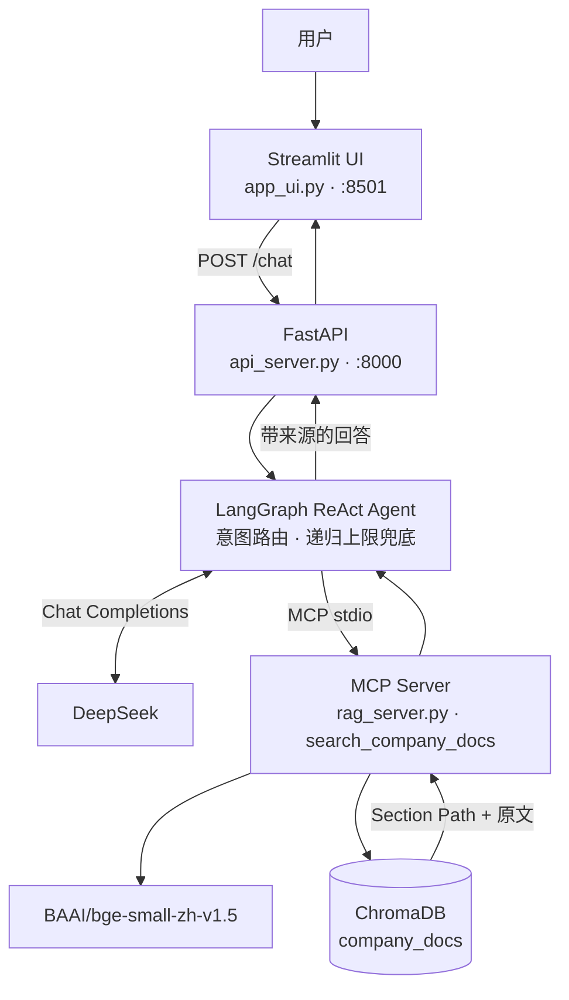

# 星辰科技企业私有化知识库客服 Agent

基于大模型、支持多跳推理的企业级 RAG 系统。面向企业内部制度、流程与产品文档，在本地完成检索与回答，并强制附带章节路径引用。

## 核心特性

- **LangGraph 状态机。** 以 ReAct Agent 组织对话。模型按问题意图决定是否检索；公司制度类问题必须先查知识库。图的递归上限为 15 步，超出后返回明确兜底，避免检索死循环。
- **MCP 标准化检索。** 向量检索封装为独立 MCP Server（`search_company_docs`），Agent 经 stdio 调用。检索实现与编排解耦，工具可单独替换。
- **结构化切块与本地向量库。** `parse_docs.py` 按章节、条款、FAQ、操作场景和表格切分 Word 文档，单块上限 800 字。向量模型为 `BAAI/bge-small-zh-v1.5`，索引持久化在 ChromaDB。
- **回答可回溯。** 每条命中结果带 Section Path 与来源文件。模型只依据检索原文作答，结论后给出「章节路径（来源文件）」。复杂问题可多轮检索后再归纳；知识库没有的条款会明确说明未找到。

覆盖范围：HR 制度、IT 支持、产品文档、合规政策、财务报销。

## 系统架构



一次提问的路径：网页把问题交给 FastAPI；LangGraph 判断是否检索，需要时通过 MCP 在 ChromaDB 中取回 Top 3 文本块；模型据此生成答案，并写明章节路径与来源文件。同一 `thread_id` 保留多轮上下文。

## 快速启动

推荐方式：在项目根目录双击 `start.bat`。

脚本会设置 Hugging Face 镜像、拉起 API（端口 8000）和 Streamlit（端口 8501），并自动打开客服页面。两个命令行窗口需保持打开。若浏览器没有弹出，访问 [http://localhost:8501](http://localhost:8501)。

### 环境要求

- Windows
- Python 3.10 及以上，且 `python` 已在 PATH 中
- DeepSeek API Key

### 启动前准备

在项目根目录安装依赖，并写入密钥。密钥只放在本机 `.env`，不要提交到仓库。

```powershell
pip install -r requirements.txt
```

`.env` 示例：

```env
DEEPSEEK_API_KEY=sk-your-key
DEEPSEEK_MODEL=deepseek-chat
```

`DEEPSEEK_MODEL` 可省略，默认 `deepseek-chat`。

然后双击 `start.bat`。首次启动会经 `https://hf-mirror.com` 下载 `BAAI/bge-small-zh-v1.5`。仓库已附带 `chunks.json` 与 `chroma_db`，索引一致时会直接复用，无需重新向量化。

等价的手动命令（两个终端，均在项目根目录）：

```powershell
python api_server.py
streamlit run app_ui.py
```

## 进阶部署（Docker）

仓库提供容器化部署文件：

| 文件 | 作用 |
| --- | --- |
| `Dockerfile.api` | FastAPI、LangGraph 与 MCP 检索服务 |
| `Dockerfile.ui` | Streamlit 前端 |
| `docker-compose.yml` | 编排 API 与 UI，挂载 `chroma_db` 和 `chunks.json` |

在项目根目录、已准备好 `.env` 后执行：

```powershell
docker compose up --build
```

- 网页： [http://localhost:8501](http://localhost:8501)
- 接口文档： [http://localhost:8000/docs](http://localhost:8000/docs)

本地 Windows 若开启系统代理或 TUN，Docker 构建与容器访问 Hugging Face、PyPI 时可能和宿主机代理冲突。`docker-compose.yml` 里的 `HTTP_PROXY` / `HTTPS_PROXY` 指向 `host.docker.internal:7897`，请改成你本机代理的实际地址；不需要代理时删掉这些变量。日常使用请优先用 `start.bat`，不依赖 Docker。

## 更新知识库

将 `.docx` 放入对应目录（`HR制度`、`IT支持`、`产品文档`、`政策文档`、`财务报销`），重新切分后重启 API。MCP 服务会按 `chunks.json` 的摘要决定复用还是重建向量库。

```powershell
pip install python-docx
python parse_docs.py
```

## 目录

```text
enterprise_kb/
├── start.bat              # 一键启动前后端
├── app_ui.py              # Streamlit 页面
├── api_server.py          # FastAPI，/chat
├── main_graph.py          # LangGraph Agent
├── rag_server.py          # MCP 检索服务
├── parse_docs.py          # 按章节 / FAQ / 表格切块
├── chunks.json            # 切块结果
├── chroma_db/             # 本地向量库
├── Dockerfile.api
├── Dockerfile.ui
└── docker-compose.yml
```
